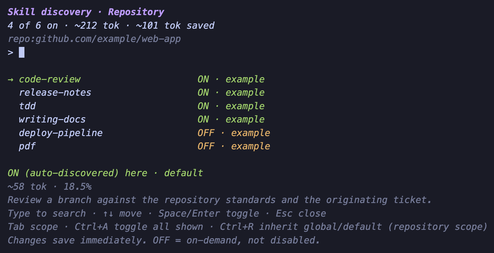

# pi-skill-toggle

Choose which skills the [Pi](https://github.com/earendil-works/pi) model sees automatically, per repository or globally. A skill that is off leaves the catalog but stays available as `/skill:<name>`.

```sh
pi install git:github.com/ioanlucut/pi-skill-toggle
```



A fresh install changes nothing until you turn a skill off.

## Commands

```text
/skill-toggle                          # picker (TUI); `list` in print, JSON, and RPC modes
/skill-toggle off code-review          # this repository; add --global for all repositories
/skill-toggle reset code-review        # drop this repository's override
/skill-toggle list                     # each skill's mode and source
```

On means auto-discovered (in the catalog); off means on-demand. In the picker: Space/Enter toggles and saves, Tab switches Repository/Global scope, Ctrl+A toggles all filtered rows, Ctrl+R resets the override, typing filters. Tab completes actions and skill names.

## Settings

`~/.pi/agent/skill-toggle.json` (or under `$PI_CODING_AGENT_DIR`). Rules apply skill lists to every repository that matches; `*` is the only wildcard.

```json
{
  "$schema": "https://raw.githubusercontent.com/ioanlucut/pi-skill-toggle/main/skill-toggle.schema.json",
  "version": 1,
  "onDemandSkills": ["pdf"],
  "projects": {},
  "rules": [
    { "repo": "github.com/my-org/*", "onDemand": ["deploy-*"] },
    { "repo": "github.com/my-org/ops", "autoDiscovered": ["deploy-pipeline"] }
  ]
}
```

Precedence, first match wins: repository override, then the last matching rule, then global `onDemandSkills`, then on. A repository is its `origin` (HTTPS and SSH count as one), so worktrees and clones share settings; without a remote, worktrees share; outside Git, the directory is the key. Changes apply to other running sessions on their next prompt.

## Limits

- Off is not a security boundary: the skill file stays readable and `/skill:<name>` still works.
- macOS and Linux only.
- No lock between sessions: two writes in the same instant can lose one change. The file is always complete and valid.

## When to use something else

Pi's own `skills` setting with `!pattern` in `.pi/settings.json` unloads a skill fully and needs a tracked project file. Use it to remove a skill; use this package to keep it on request with no file in the repository. Similar gallery packages (`pi-skill-gate`, `@tbolp/pi-skill-manager`, `@spences10/pi-skills`, `pi-toggle-skills`, `pi-prompt-control`) do not give one identity per repository across worktrees and clones, repository rules, and catalog token cost together.

## Development

```sh
npm ci
npm run typecheck
npm test                  # unit tests with coverage floors
npm run test:integration  # real Pi session from the `pi` on PATH (or PI_PACKAGE_DIR)
```
